<div align="center">

# ProofTrail

**An explicit-state model checking and formal verification workbench**

Describe a finite system in YAML or JSON, state what must (or must not) happen,
and get either a proof within the model or a shortest counterexample you can replay.


</div>

```text
$ prooftrail check examples/counter/unsafe_counter.yaml

[FAIL] counter-bound  (invariant) -> VIOLATED
       The counter never exceeds 3.
       counterexample (finite, 4 step(s)):
         [0] (initial) counter=0
         [1] --increment--> counter=1
         [2] --increment--> counter=2
         [3] --increment--> counter=3
         [4] --increment--> counter=4
```

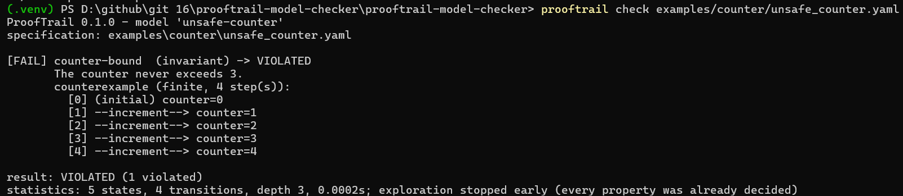

## Contents

- [Why ProofTrail](#why-prooftrail)
- [Installation](#installation)
- [Quick start](#quick-start)
- [Writing a model](#writing-a-model)
- [What a result means](#what-a-result-means)
- [Evidence: counterexamples, CTL and reports](#evidence-counterexamples-ctl-and-reports)
- [Architecture](#architecture)
- [Examples](#examples)
- [Quality evidence](#quality-evidence)
- [Benchmarks](#benchmarks)
- [Limitations](#limitations)
- [Documentation](#documentation)
- [Contributing, security and citation](#contributing-security-and-citation)

## Why ProofTrail

Most model-checking tutorials stop at "BFS found a bad state". ProofTrail is built
around the parts that make a verifier trustworthy:

| | |
|---|---|
| **Honest verdicts** | `HOLDS`, `VIOLATED`, `UNKNOWN` and `ERROR` are different outcomes. Running out of budget is never reported as success. |
| **Shortest counterexamples** | Breadth-first search guarantees the fewest steps to a violation. Liveness failures come back as *lasso* traces (a prefix plus a loop). |
| **Evidence is re-checked** | Every trace is validated against the model before it is reported, and `explain --model` replays saved reports independently. |
| **Real temporal logic** | CTL (`EX AX EF AF EG AG`, `E[.U.]`, `A[.U.]`) by fixed-point computation, plus a `response` shorthand. |
| **Untrusted input is safe** | No `eval`. Expressions go through an allow-listed evaluator; YAML aliases, duplicate keys and oversized files are rejected. |
| **Reproducible** | A hand-derived corpus of 33 models and benchmarks whose every number is measured by a script. |

The core engine depends only on PyYAML and does not rely on any external model-checker library.

## Installation

Requires **Python 3.12 or newer**.

Windows (PowerShell):

```powershell
git clone <this repository>
cd prooftrail-model-checker
py -3.12 -m venv .venv
.\.venv\Scripts\Activate.ps1
python -m pip install --upgrade pip
python -m pip install -e ".[dev,visualization]"
```

Linux / macOS:

```bash
git clone <this repository>
cd prooftrail-model-checker
python3 -m venv .venv
source .venv/bin/activate
python -m pip install -e ".[dev,visualization]"
```

The `visualization` extra adds `networkx` and `matplotlib` (PNG graphs and benchmark charts);
the `dev` extra adds the test and lint tools. Check the install with `prooftrail --version`.

## Quick start

```text
prooftrail validate examples/counter/unsafe_counter.yaml     # check the specification
prooftrail check    examples/counter/safe_counter.yaml       # verify every property
prooftrail check    examples/counter/unsafe_counter.yaml --format json -o reports/counter.json
prooftrail explain  reports/counter.json --model examples/counter/unsafe_counter.yaml
prooftrail graph    examples/traffic_light/model.yaml --format mermaid
prooftrail corpus   examples/manifest.json                   # run the 33-case corpus
```

From Python:

```python
from prooftrail import load_specification, verify

spec = load_specification("examples/counter/unsafe_counter.yaml")
run = verify(spec.system, spec.properties)
for result in run.results:
    print(result.property_id, result.status)  # counter-bound VIOLATED
```

Useful options for `check`: `--property ID` (repeatable), `--max-states N`, `--max-depth N`,
`--timeout SECONDS`, `--indexing {object,packed}`, `--strategy {shared,per-property}`,
`--cache`, `--memory`, `--no-timing` (byte-reproducible reports) and `--no-traces`.

| Exit code | Meaning |
|---|---|
| `0` | every property holds |
| `1` | at least one property is violated |
| `2` | error (bad specification, modelling error, ...) |
| `3` | only inconclusive results (`UNKNOWN`) |

## Writing a model

A model is a set of typed variables and guarded transitions; properties say what to check.
This one has an intentional off-by-one bug in its guard:

```yaml
schema_version: "1.0"
model:
  id: unsafe-counter
  variables:
    counter: { type: integer, initial: 0 }
  transitions:
    - id: increment
      when: "counter <= 3"            # bug: should be "counter < 3"
      updates: { counter: "counter + 1" }
properties:
  - id: counter-bound
    type: invariant
    expression: "counter <= 3"
```

| Property type | Question it answers |
|---|---|
| `invariant` | Does every reachable state satisfy the expression? |
| `reachability` | Can a state satisfying the target be reached? (witness path on success) |
| `deadlock_free` | Is there a reachable state with no enabled transition (optionally excluding intended terminal states via `unless`)? |
| `ctl` | Does a CTL formula hold in every initial state? |
| `response` | Is every `trigger` eventually followed by `response`? (`AG (trigger -> AF response)`) |

Variables are `integer` (optionally bounded), `boolean` or `enum`. Expressions support
arithmetic, comparisons, `and`/`or`/`not`, `in`, and conditional expressions; nothing else.
The precise definitions are in [docs/formal-semantics.md](docs/formal-semantics.md).

## What a result means

| Status | Meaning |
|---|---|
| `HOLDS` | Confirmed for the model, under the documented semantics. For safety properties this requires an exhaustive exploration. |
| `VIOLATED` | A valid counterexample exists (or, for reachability, the target is provably unreachable). |
| `UNKNOWN` | Inconclusive: a limit (`--max-states`, `--max-depth`, `--timeout`) stopped the search first. |
| `ERROR` | The run failed, for example a transition assigned a value outside a variable's domain. Never a verdict on the model. |

A verdict is a statement about the model as written. It does not prove that the model faithfully describes a real system.

## Evidence: counterexamples, CTL and reports

**Lasso counterexample for a liveness property.** In the modulo-4 counter, `AF {x == 5}` fails
because the cycle never reaches 5. The counterexample is a finite prefix plus the edge that closes the loop,
and `five-reachable` is reported as provably unreachable after exhausting all 4 states:

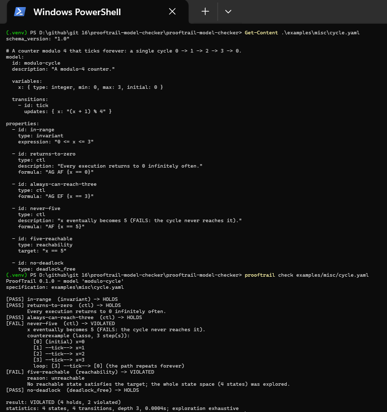

**Structured JSON report.** Every verdict, statistic, the complete trace, the specification's
SHA-256 and the environment are stored, so a result can be audited later with `prooftrail explain`:

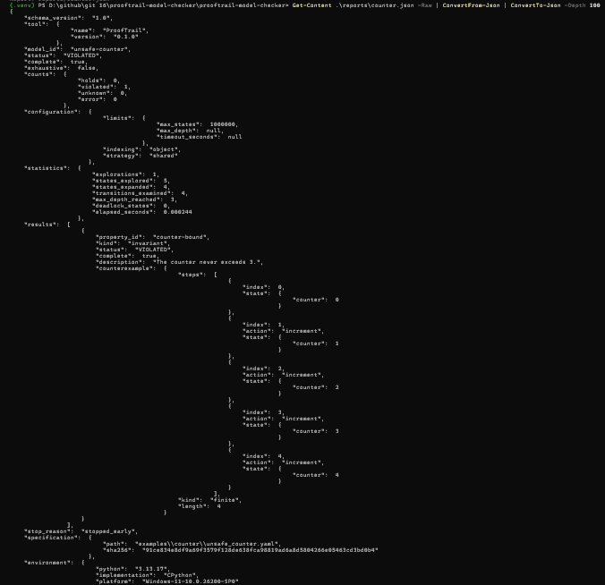

**State-space graph.** `prooftrail graph` emits Mermaid, DOT or PNG. The traffic-light model's
five reachable states render directly on GitHub:

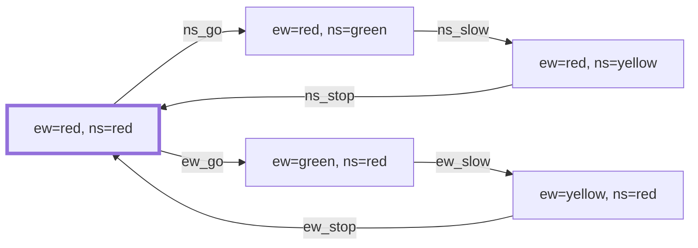

<details>
<summary>The command that produced it</summary>

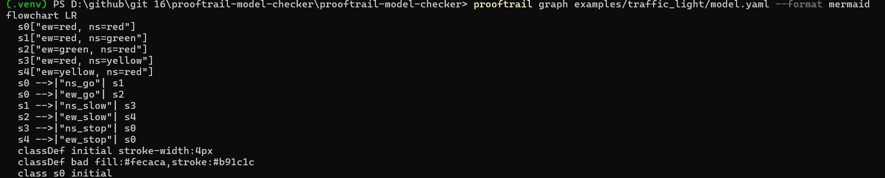

</details>

## Architecture

The engine never depends on the command line, reports or pictures; interfaces depend on the engine.

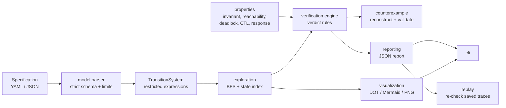

Details: [docs/architecture.md](docs/architecture.md) and [docs/algorithms.md](docs/algorithms.md).

## Examples

| Model | What it shows |
|---|---|
| [`counter/`](examples/counter) | Safe and defective bounded counter; every verdict kind |
| [`traffic_light/`](examples/traffic_light) | State machine with safety and liveness (CTL) properties |
| [`producer_consumer/`](examples/producer_consumer) | Bounded buffer, plus a variant that overflows |
| [`resource_protocol/`](examples/resource_protocol) | Lock-ordering deadlock, and the ordered fix |
| [`peterson/`](examples/peterson) | Peterson's mutual exclusion, and a broken variant with a 6-step counterexample |
| [`misc/`](examples/misc) | Cycles, several initial states, a diamond, a long trace |
| [`invalid/`](examples/invalid) | Specifications that must be rejected, including code injection |

[`examples/manifest.json`](examples/manifest.json) pairs each model with its expected answers
and a written derivation of how each answer was reached **without running the tool**.

## Quality evidence

Measured on a Windows 11 machine with CPython 3.13, pytest 9 and coverage.py 7.17.

| Check | Result |
|---|---|
| Test cases | 2276 (unit, integration, regression, randomized differential tests) |
| Line + branch coverage | **96%** (2561 statements, 940 branches) |
| `ruff check` / `ruff format --check` | clean, 70 files |
| Example corpus | **33 / 33** cases pass |

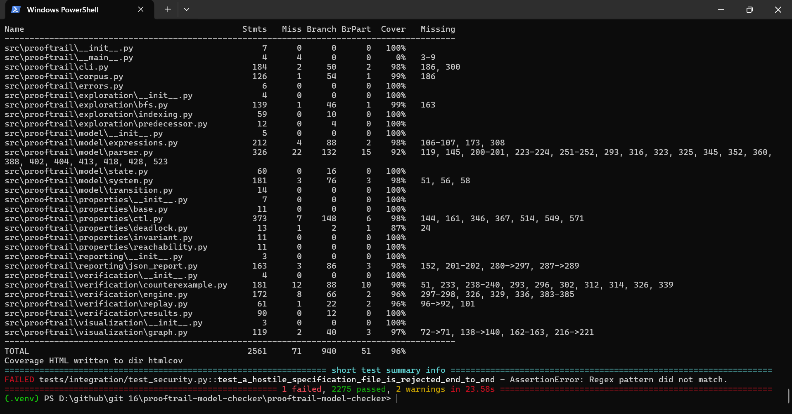

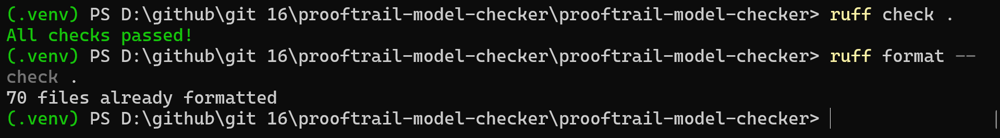

<details>
<summary>Corpus run: 33 of 33 cases pass</summary>

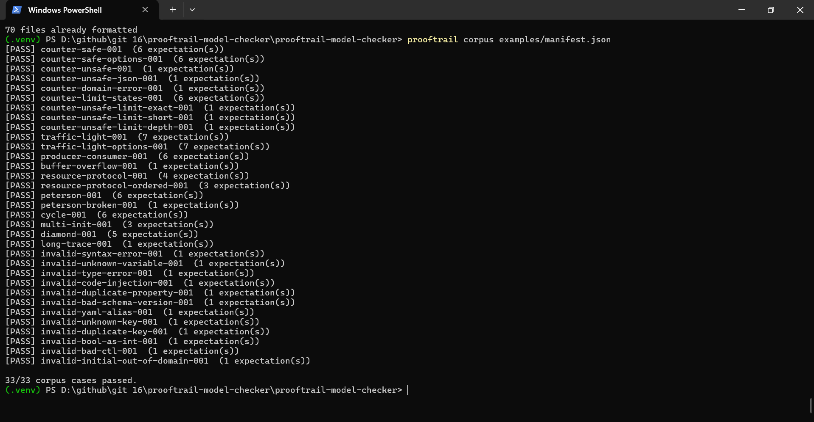

</details>

How the claims are tested, and what is deliberately *not* claimed, is in
[docs/correctness.md](docs/correctness.md). Coverage shows which code ran, not that the code is correct;
the differential tests compare the engine with independent references (set closure,
`networkx` shortest paths, a naive CTL fixed-point iteration).

Reproduce:

```text
python -m pytest --cov=prooftrail --cov-branch --cov-report=term-missing --cov-report=html
ruff check . && ruff format --check .
prooftrail corpus examples/manifest.json
```

## Benchmarks

```text
python benchmarks/run_benchmarks.py           # full run (several minutes)
python benchmarks/run_benchmarks.py --quick   # smoke test
```

The generators have closed-form state counts, and the runner aborts if the engine disagrees.
The charts below come from one full run (2 vCPU Xeon 2.1 GHz, CPython 3.13); every number is in
[`benchmarks/results/RESULTS.md`](benchmarks/results/RESULTS.md). Absolute times depend on hardware;
compare shapes, not milliseconds. Method and threats to validity:
[docs/benchmark-methodology.md](docs/benchmark-methodology.md).

| Finding | Measured |
|---|---|
| Runtime vs. states + transitions | near-linear: log-log slope 1.14 over 16 to 65 536 states |
| `packed` vs. `object` indexing | about one fifth of the peak memory at 65 536 states, same runtime |
| Storing predecessor links | within run-to-run noise: state objects dominate memory |
| Successor cache | slower and larger for one shared exploration; faster for repeated explorations |
| Property count | runtime grows with the number of properties (each state is checked against all of them) |
| Counterexample length | 30 000-step trace found, rebuilt and re-validated in about 0.28 s |

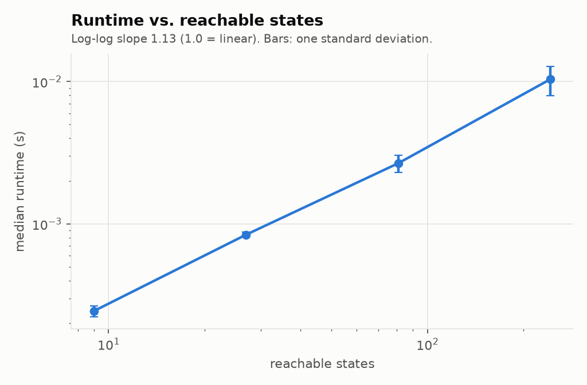

| | |
|---|---|
| 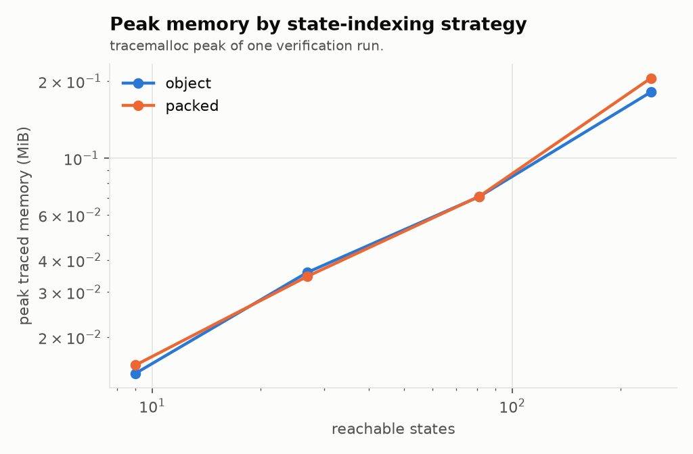 | 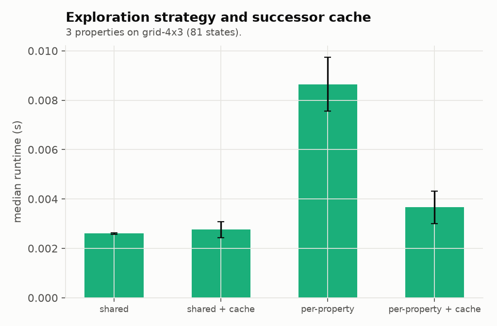 |
| 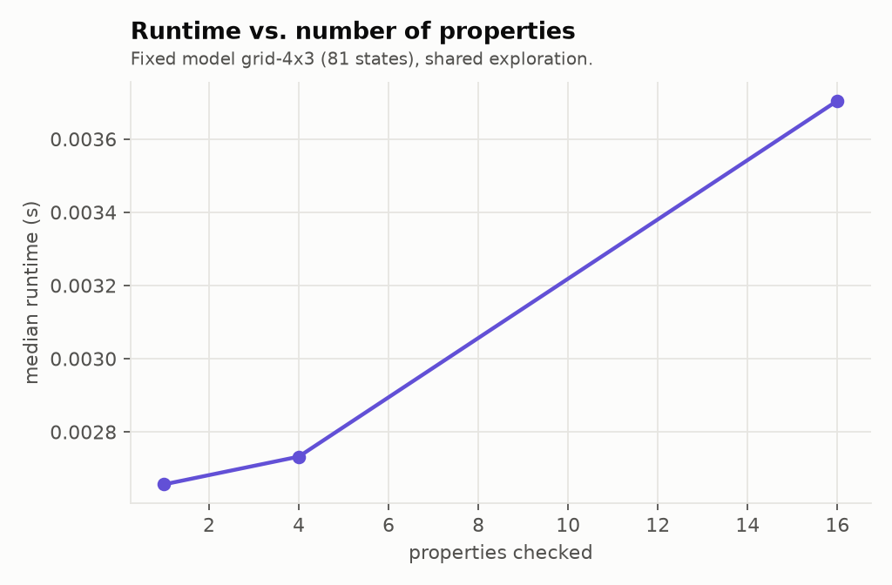 | 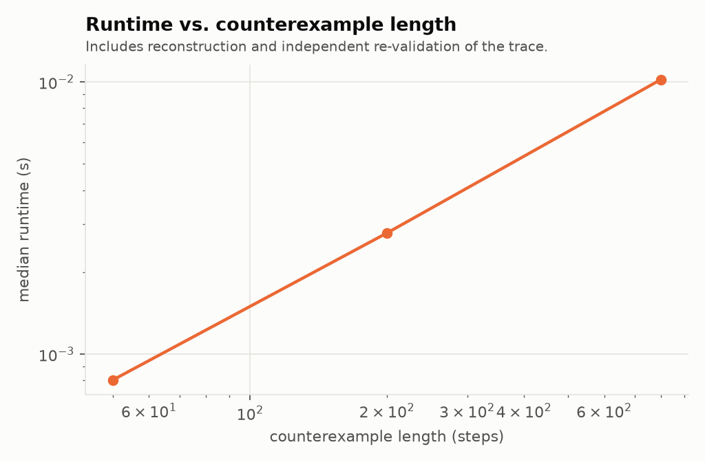 |

## Limitations

- Explicit-state search faces state-space explosion; the engine is pure Python and aimed at small
  and medium models, teaching and research.
- CTL only: no LTL, no CTL*, **no fairness assumptions** (`AF` fails if any path avoids the goal forever).
- No symmetry or partial-order reduction. The indexing strategies and the successor cache are engineering
  options that never change a verdict.
- Variables are `integer`, `boolean` and `enum`; no arrays or records.
- Not cross-checked against an external tool such as TLC.

Full discussion: [docs/limitations.md](docs/limitations.md).

## Documentation

| Document | Topic |
|---|---|
| [Architecture](docs/architecture.md) | Layers, dependency rules, design decisions |
| [Formal semantics](docs/formal-semantics.md) | Transition systems, CTL, totalization, verdict rules |
| [Algorithms](docs/algorithms.md) | BFS, indexing, CTL fixed points, complexity |
| [Correctness](docs/correctness.md) | Claims and how each is checked |
| [Security](docs/security.md) | Threat model and controls |
| [Benchmark methodology](docs/benchmark-methodology.md) | Procedure and threats to validity |
| [Limitations](docs/limitations.md) | What the tool does not do |
| [Design decisions](research/design-decisions) | Short ADRs |

## Contributing, security and citation

- Contributions: [CONTRIBUTING.md](CONTRIBUTING.md)
- Vulnerability reports: [SECURITY.md](SECURITY.md)
- Citing: [CITATION.cff](CITATION.cff)

## License

MIT. See [LICENSE](LICENSE).
