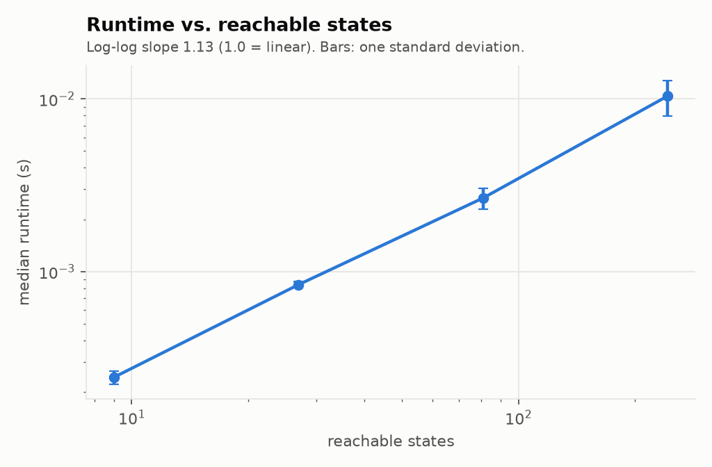
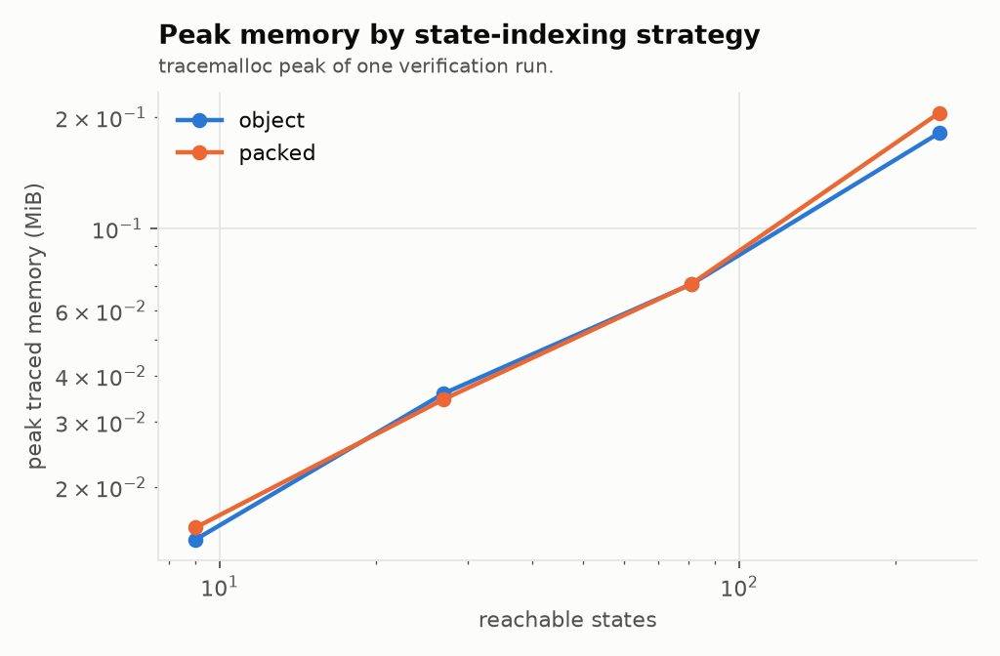
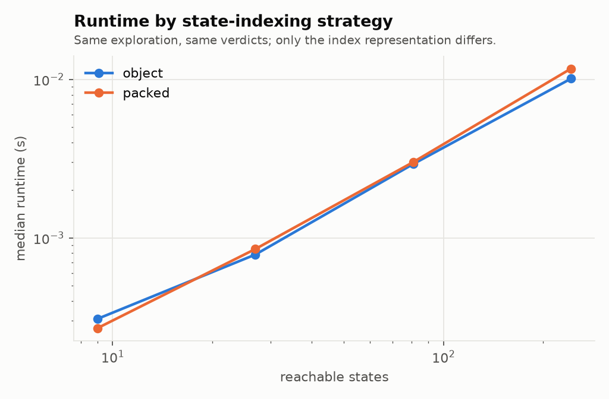
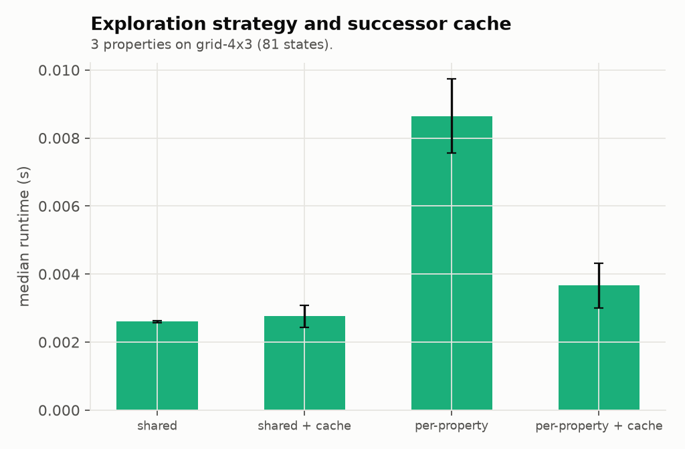
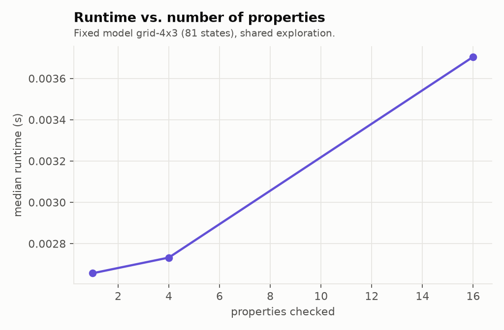
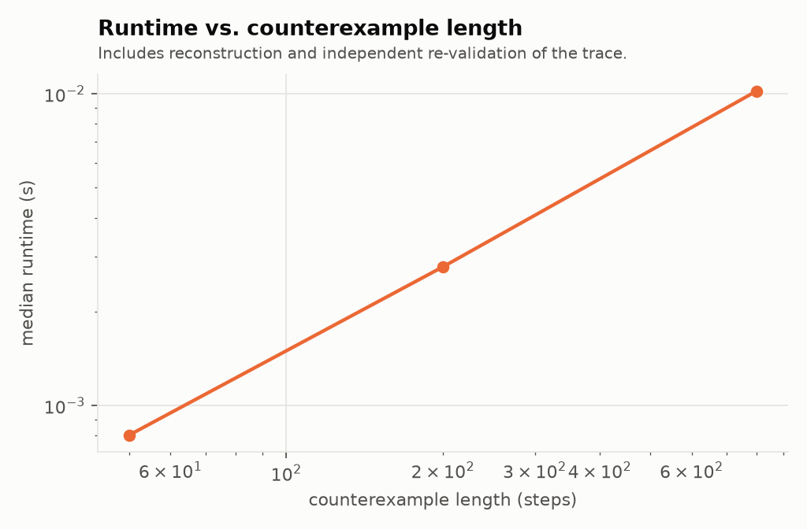

# Benchmark results

Generated by `benchmarks/run_benchmarks.py`; do not edit by hand.

- ProofTrail 0.1.0, CPython 3.13.17
- Windows-11-10.0.26200-SP0 (AMD64), 8 logical CPUs
- CPU: Intel64 Family 6 Model 140 Stepping 1, GenuineIntel
- Repeats per case: 3 (after one warm-up run)
- Run mode: quick

## E1. State-space growth

| model | states | transitions | median ms | stdev ms | peak MiB |
|---|---|---|---|---|---|
| grid-2x3 | 9 | 24 | 0.24 | 0.02 | 0.02 |
| grid-3x3 | 27 | 108 | 0.84 | 0.04 | 0.04 |
| grid-4x3 | 81 | 432 | 2.67 | 0.37 | 0.07 |
| grid-5x3 | 243 | 1,620 | 10.40 | 2.43 | 0.18 |

Empirical log-log slope of runtime against states: **1.13**.

## E2. State indexing

| variant | model | median ms | peak MiB |
|---|---|---|---|
| object | grid-2x3 | 0.31 | 0.01 |
| packed | grid-2x3 | 0.27 | 0.02 |
| object | grid-3x3 | 0.78 | 0.04 |
| packed | grid-3x3 | 0.85 | 0.03 |
| object | grid-4x3 | 2.92 | 0.07 |
| packed | grid-4x3 | 3.01 | 0.07 |
| object | grid-5x3 | 10.11 | 0.18 |
| packed | grid-5x3 | 11.70 | 0.21 |

## E3. Predecessor storage

| variant | model | median ms | peak MiB |
|---|---|---|---|
| without | grid-2x3 | 0.19 | 0.01 |
| with predecessors | grid-2x3 | 0.21 | 0.01 |
| without | grid-3x3 | 0.65 | 0.03 |
| with predecessors | grid-3x3 | 0.65 | 0.03 |
| without | grid-4x3 | 2.43 | 0.07 |
| with predecessors | grid-4x3 | 2.77 | 0.07 |
| without | grid-5x3 | 10.49 | 0.18 |
| with predecessors | grid-5x3 | 11.20 | 0.18 |

## E4. Strategy and successor cache

| variant | explorations | median ms | peak MiB |
|---|---|---|---|
| shared | 1 | 2.60 | 0.07 |
| shared + cache | 1 | 2.76 | 0.27 |
| per-property | 3 | 8.65 | 0.17 |
| per-property + cache | 3 | 3.66 | 0.28 |

## E5. Number of properties

| properties | median ms | stdev ms |
|---|---|---|
| 1 | 2.66 | 0.34 |
| 4 | 2.73 | 0.42 |
| 16 | 3.70 | 0.36 |

## E6. Counterexample length

| steps | median ms | peak MiB |
|---|---|---|
| 50 | 0.80 | 0.05 |
| 200 | 2.79 | 0.14 |
| 800 | 10.21 | 0.57 |

## Charts

