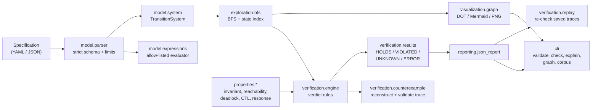

# Architecture

ProofTrail is a small explicit-state model checker. The design rule that shapes
everything else is a one-way dependency order: the **engine does not know about
the command line, report files or pictures**. Interfaces depend on the engine,
never the other way round.



## Layers

| Layer | Package | Responsibility |
|---|---|---|
| Model | `prooftrail.model` | Immutable `State`, `Transition`, `TransitionSystem`, the restricted expression language and the strict specification parser. No exploration logic. |
| Exploration | `prooftrail.exploration` | Breadth-first search, dense state indexing (two interchangeable strategies), predecessor links. Knows nothing about properties; callers pass callbacks. |
| Properties | `prooftrail.properties` | Property definitions (invariant, reachability, deadlock freedom, CTL, response) and the CTL fixed-point checker. |
| Verification | `prooftrail.verification` | The engine that combines exploration with properties, the verdict rules, counterexample reconstruction and **independent trace validation**, and replay of saved reports. |
| Reporting | `prooftrail.reporting` | Versioned JSON report schema, reading and validating reports. |
| Visualization | `prooftrail.visualization` | Renders a bounded snapshot of the state graph. Read-only: it never decides anything about a property. |
| CLI | `prooftrail.cli` | Argument parsing, exit codes, text output. Thin. |
| Corpus | `prooftrail.corpus` | Runs a manifest of models with independently derived expected answers. |

## Key design decisions

1. **States are immutable and hashable** (`State` is a frozen, slotted
   dataclass over a sorted tuple of name/value pairs), so the visited set is a
   plain dictionary and dictionary order never changes semantics.
2. **State indexing is pluggable** (`object` and `packed`). Both assign the same
   ids in the same order, so the choice can never change a verdict; it only
   trades memory against decoding time (see the benchmarks).
3. **Exploration is callback-driven.** The engine passes `on_discover` and
   `on_expand` hooks, so safety properties can stop the search the moment every
   property is decided, while temporal properties force a full exploration.
4. **Errors are never verdicts.** Parse errors raise `SpecError`; modelling
   errors found during exploration (value outside a declared domain, division
   by zero) end the exploration as incomplete and surface as `ERROR` for the
   unresolved properties only.
5. **Evidence is re-validated.** Before a counterexample is reported, the engine
   replays it against the transition system. A trace that fails validation
   becomes `ERROR` (an engine bug), never a bogus `VIOLATED`.
6. **The core has no third-party dependency except PyYAML.** `networkx` and
   `matplotlib` are optional extras used only for visualization and benchmark
   charts.

## Repository layout

```
src/prooftrail/     the package (see the table above)
tests/              unit, integration, properties, regression
examples/           models, invalid specs and manifest.json (the corpus)
benchmarks/         generators, runner and committed results
docs/               this documentation
research/           design decisions and experiment notes
scripts/            small helper scripts
```
